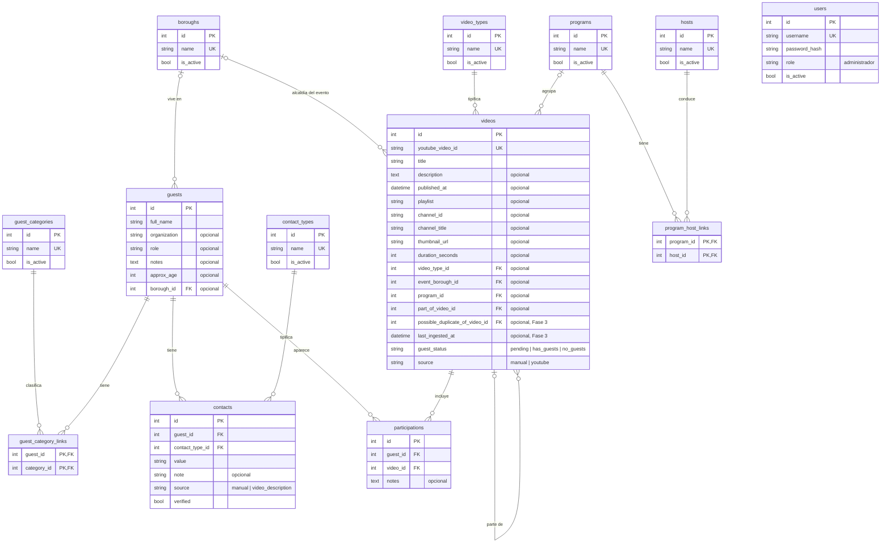
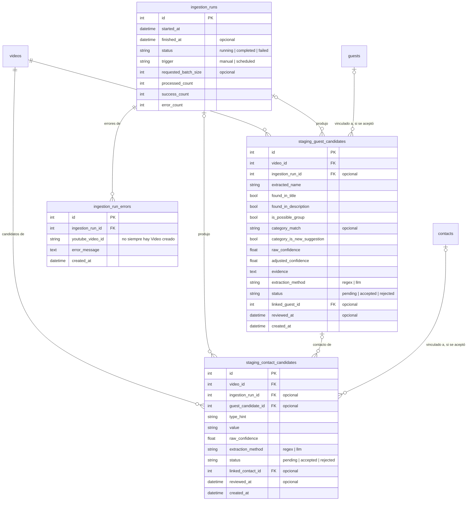

# Modelo de datos — X Live Medios

Deriva de la sección 5 de `PROJECT_BRIEF.md`. Tablas y columnas en inglés.
No existe `Season` (no hay temporadas). `users` (Fase 2) se agrega abajo, sin relaciones con
el resto. Las tablas de staging de la ingesta con IA (Fase 3: `ingestion_runs`,
`ingestion_run_errors`, `staging_guest_candidates`, `staging_contact_candidates`) se documentan
al final, aparte del diagrama principal para no saturarlo.

## Diagrama ER

## Reglas por tabla

### Catálogos
`guest_categories`, `video_types`, `contact_types`, `boroughs`, `programs` y `hosts` comparten forma:
`id`, `name` único, `is_active` (desactivar en lugar de borrar, para no romper referencias).
Se administran desde la app (agregar, renombrar, desactivar). Fusionar categorías (FR-004) sigue pendiente.
La unicidad del nombre se valida en la aplicación ignorando mayúsculas, acentos y espacios extra;
la restricción `UNIQUE` de la BD solo cubre el nombre exacto.
- Solo `boroughs` se precarga (16 alcaldías de CDMX). Los demás empiezan vacíos: no se inventan datos.
- `guest_categories` = tipo de talento del invitado.
- `hosts` = conductores (quienes presentan un programa; no son invitados). Migración `0005`.

### program_host_links
Relación N↔N Program–Host, con clave primaria compuesta (`program_id`, `host_id`). Un programa puede tener
varios conductores y un conductor varios programas. La asignación es por programa (no por video). Se edita
desde Catálogos → Programas con `PUT /program-hosts/{program_id}` (reemplaza el conjunto completo).

### guests
- Un registro por persona; no se duplica por aparecer en varios videos.
- Solo `full_name` es obligatorio. Edad, alcaldía, organización, rol y notas son opcionales.
- `approx_age` guarda edad aproximada (búsqueda por rangos), `CHECK approx_age >= 0`.
- `borough_id` = alcaldía donde vive el invitado (opcional).

### guest_category_links
Relación N↔N Guest–GuestCategory. Clave primaria compuesta (`guest_id`, `category_id`), por lo que no se repite la misma categoría. Un invitado puede tener cero categorías.

### contacts
- Un invitado tiene 0..N contactos. Tipo por catálogo (`contact_types`), sin campos vacíos por tipo.
- `source`: `manual` o `video_description`. `verified` indica validación humana.
- El patrocinador es un contacto de tipo "patrocinador" con valor y `note` (ej. nombre de la empresa).
- Nunca se inventan valores.

### videos
- `youtube_video_id` único: evita ingesta duplicada. Los metadatos de YouTube viven en columnas propias del video, separados de las entidades de dominio (invitados, participaciones).
- `video_type_id`, `program_id`, `event_borough_id`, `part_of_video_id`: todos opcionales.
- `part_of_video_id` autorreferencia ("parte 2 de otro video"), `CHECK part_of_video_id <> id`.
- `guest_status`: `pending` (aún sin revisar), `has_guests`, `no_guests` (propuesta de la IA, reclasificable por un humano; FR-014).
- `source`: `manual` (cargado desde la app, migración `0004`) o `youtube` (lo trae la ingesta de la Fase 3). Permite localizar y borrar los videos de prueba cuando lleguen los reales. Los videos existentes al migrar quedan como `manual`.
- `possible_duplicate_of_video_id` (Fase 3, migración `0006`): autorreferencia que el orquestador llena cuando título+descripción normalizados coinciden con otro video y `published_at` está a ±14 días (evidencia real de 150 videos, ver `PHASE3_PLAN.md`); nunca se fusiona ni descarta solo, un humano lo confirma o limpia el campo desde la app.
- `last_ingested_at` (Fase 3, migración `0007`): cuándo lo procesó por última vez el orquestador (reglas + LLM); `NULL` = todavía no. Permite que una corrida no reprocese lo ya hecho.

### users
Usuarios de la app (migración `0003`). `username` único, contraseña solo como hash (argon2), `role` en texto
(hoy solo `administrador`) e `is_active`. Sin relación con las demás tablas: aún no se registra quién hizo cada cambio.

### participations
- Aparición de un invitado en un video (N↔N). `UNIQUE (guest_id, video_id)`.
- Un video puede tener cero participaciones. No se crean participaciones vacías para videos sin invitados.

## Tablas de staging (Fase 3, migración `0006`)
Todo lo que produce la ingesta (reglas de regex + LLM) es candidato: vive aparte de `guests`/
`contacts` hasta que un humano lo acepta, edita o rechaza en Staging Review. No están en el
diagrama principal porque no se relacionan con el resto del modelo de dominio, solo con
`videos` y, una vez aceptadas, con `guests`/`contacts`.

- **`ingestion_runs`**: historial de corridas del orquestador (fecha, estado, disparador,
  conteos). **`ingestion_run_errors`**: un error puntual dentro de una corrida; no detiene el
  resto del lote, se borra en cascada si se borra la corrida.
- **`staging_guest_candidates`**: `raw_confidence` es la cruda (del LLM o un valor fijo por
  patrón de regex); `adjusted_confidence` le suma el ajuste por señales objetivas (+0.15 si el
  nombre aparece en título y descripción, +0.10 solo en título, −0.20 si es posible grupo;
  valores iniciales de `app/services/pipeline.py`, ajustables tras validar con resultados
  reales). Staging Review ordena por el ajuste, no por la cruda. `extraction_method` distingue
  si lo encontró un patrón de regex o el LLM. `linked_guest_id` se llena al aceptar.
- **`staging_contact_candidates`**: `guest_candidate_id` es opcional — si es `NULL`, el
  contacto es a nivel video/evento (p. ej. un patrocinador), no de un invitado en concreto. El
  invitado al que se atribuye al aceptar (`ContactCandidateAccept.guest_id`) siempre lo elige
  quien revisa, nunca se infiere solo de este campo.
- `ingestion_run_id` en ambas tablas de candidatos usa `ON DELETE SET NULL` (no `CASCADE`): un
  candidato pendiente de revisión no debe perderse aunque se borre el historial de su corrida.

## Decisiones a confirmar
1. `playlist` como texto simple en `videos`. Si luego se necesita jerarquía de playlists, se convierte en tabla.
2. `ON DELETE`: catálogos → `RESTRICT` (se desactivan, no se borran con uso); `contacts`,
   `guest_category_links`, `participations` y las tablas de staging que cuelgan de un video →
   `CASCADE` al borrar el invitado o el video.

## Preguntas abiertas (no asumidas)
Lista de programas, datos del patrocinador, historial de cambios, plazo de "sin contactar",
aviso de privacidad (LFPDPPP, pendiente con el Ing. Israel antes de la carga histórica masiva
de la Fase 7 — ver `PHASE3_PLAN.md`).
